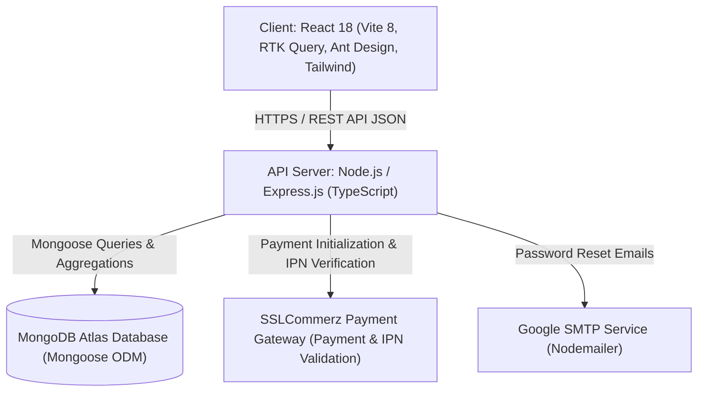
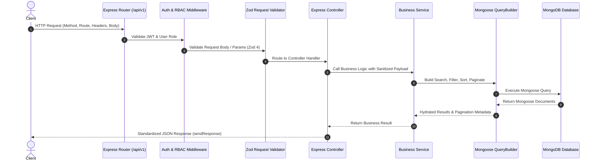
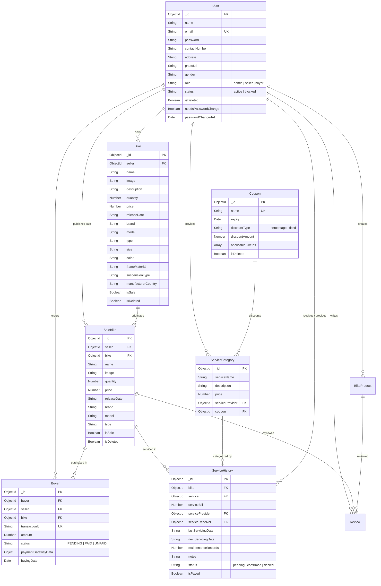
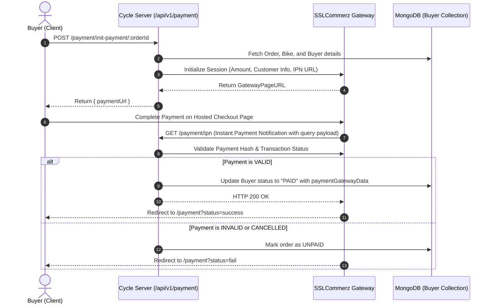

# Cycle Control Hub (Bikeside) - System Architecture & Engineering Blueprint

This document details the software architecture, data modeling, component boundaries, asynchronous flows, and design patterns governing **Cycle Control Hub (Bikeside)**.

---

## 1. High-Level System Architecture

Cycle Control Hub is architected as a decoupled, multi-tier full-stack system consisting of a **React 18** client (Vite 8, Ant Design, Tailwind CSS, Redux Toolkit), an **Express.js TypeScript** REST API server, **Mongoose ODM**, **MongoDB Atlas**, **SSLCommerz Payment Gateway**, and **Google SMTP (Nodemailer)**.

---

## 2. Layered Application Architecture (Server)

The backend implements a modular, layered design pattern enforcing strict separation of concerns across each incoming request:

### Layer Responsibilities

1. **Routing Layer (`src/app/routes/` & `*.route.ts`)**: Registers modular route groups under the `/api/v1` namespace.
2. **Middleware Layer (`src/app/middleware/`)**:
   - `auth.ts`: Decodes and validates JWT bearer tokens, verifies user active status, and enforces user role constraints (`admin`, `seller`, `buyer`).
   - `validateRequest.ts`: Intercepts and parses incoming request bodies against strongly typed Zod 4 validation schemas.
   - `globalErrorHandler.ts`: Catches unhandled exceptions, maps CastError, Duplicate Key (11000), and ZodError to unified HTTP response envelopes, stripping sensitive internals in production.
3. **Controller Layer (`*.controller.ts`)**:
   - Extracts request body, route parameters (`req.params`), query strings (`req.query`), and authenticated user metadata (`req.user`).
   - Enforces asynchronous safety via `catchAsync`.
   - Formats client responses via `sendResponse()`.
4. **Service Layer (`*.service.ts`)**:
   - Encapsulates domain logic, stock level validations, price calculations, loyalty discount computations, and external service calls (SSLCommerz, Nodemailer).
   - Enforces strict Object-Level Authorization (IDOR guards).
5. **Query Builder Layer (`src/app/builder/QueryBuilder.ts`)**:
   - Fluent query pipeline applying `.search()`, `.filter()`, `.sort()`, `.paginate()`, and `.fields()`.
   - Automatically sanitizes query parameters against NoSQL operator injection (stripping keys starting with `$`) and escapes regular expression metacharacters to prevent ReDoS.
6. **Data Access Layer (`*.model.ts`)**:
   - Mongoose schemas, type interfaces, pre-save hooks (e.g. bcrypt password hashing), and document relationships.

---

## 3. Database Entity Relationship Model

The MongoDB Atlas database represents relationships through ObjectId references and embedded payment metadata:

---

## 4. Payment Gateway & Checkout Flow (SSLCommerz)

---

## 5. Role-Based Access Control (RBAC) Matrix

| Resource / Endpoint | Buyer | Seller | Admin | Notes |
| :--- | :---: | :---: | :---: | :--- |
| **Auth & Profile** |
| Register & Login | ✅ | ✅ | ✅ | Public registration defaults to `buyer` |
| View My Profile | ✅ | ✅ | ✅ | Own profile only |
| Update User Profile | ✅ (Self) | ✅ (Self) | ✅ (All) | Scoped to own record unless Admin |
| Change Role / Status | ❌ | ❌ | ✅ | Admin-only security control |
| **Bike Inventory** |
| View All Bikes | ✅ | ✅ | ✅ | Public catalog browsing |
| Add / Create Bike | ❌ | ✅ | ✅ | Seller & Admin catalog creation |
| Update / Delete Bike | ❌ | ✅ (Own) | ✅ (All) | IDOR-protected; seller must own bike |
| Bulk Delete Bikes | ❌ | ✅ | ✅ | Multi-selection removal |
| **Sales & Ordering** |
| Purchase Bike | ✅ | ✅ | ✅ | Instant quantity decrement |
| Cancel Purchase | ✅ (Own) | ❌ | ✅ (All) | IDOR-protected; auto-restocks stock |
| Sales Reports (Daily/Weekly) | ❌ | ✅ | ✅ | Recharts analytical views |
| **Servicing & Maintenance** |
| Request Service | ✅ | ❌ | ❌ | Buyer initiates service ticket |
| Confirm / Deny Service | ❌ | ✅ | ✅ | Service provider confirms ticket |
| Apply Coupon / Loyalty | ✅ | ❌ | ❌ | 5% per maintenance (max 50%) |
| Mark Service Paid | ✅ | ❌ | ❌ | Buyer payment settlement |
| **Coupons & Management** |
| Create / Update Coupon | ❌ | ❌ | ✅ | Admin promotional management |
| Delete Coupon | ❌ | ❌ | ✅ | Soft-deletion (`isDeleted: true`) |
